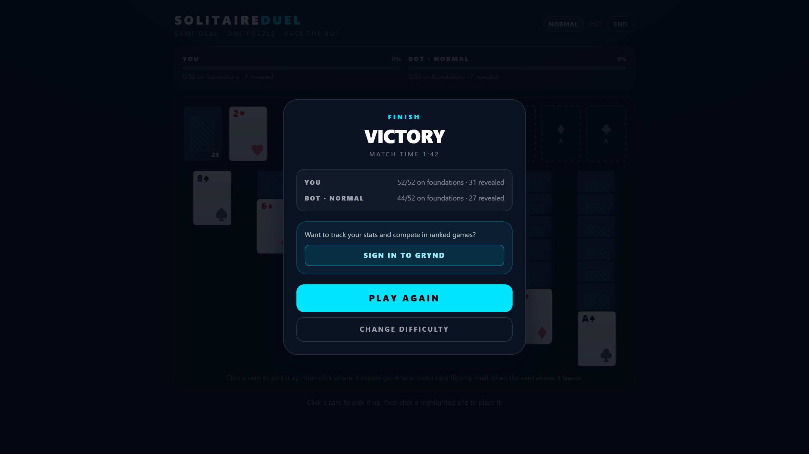

# Solitaire Duel — portal package

One self-contained folder plus the artwork a portal's submission form asks for.
No server, no runtime configuration, and no network calls in the default build.

---

## 1. Build

```bash
npm install                        # once
npm run build:portal:solitaire     # -> dist/portal/solitaire-duel/
```

The itch.io deliverable has its own command, which builds, zips and re-reads the
archive as it goes:

```bash
npm run package:itch:solitaire     # -> dist/packages/solitaire-duel-itch.zip
npm run verify:itch:solitaire      # validates that ZIP, then plays the extracted copy offline
```

`npm run package:portal:solitaire` (artwork → build → zip) still exists and
writes the same archive.

Local checks:

```bash
npm run dev:solitaire-standalone   # dev server on http://localhost:4319
npm run test:solitaire-standalone  # engine + controller + isolation tests
npm run verify:portal:solitaire    # drives the BUILT package in Chrome, offline
npm run verify:itch:solitaire      # same, against the extracted ZIP
```

`verify:portal:solitaire` needs Chrome (set `CHROME_PATH` if it is not in a
standard location). It serves the package from `127.0.0.1`, blocks all `https`
and `wss` traffic in the browser, plays a match, and fails on any off-origin
request, `/api/` request, blocked request, or console error.

## 2. Output

```
dist/portal/solitaire-duel/
  index.html                  <- the entry point, AT THE ROOT of this folder
  favicon.ico                 <- 32 px icon for the browser tab
  favicon.svg                 <- the same mark, scalable
  favicon-32.png
  apple-touch-icon.png        <- 180 px
  icon-512.png                <- the game icon portal forms ask for
  assets/index-<hash>.js      <- React + the game + the shared GRYND engine
  assets/index-<hash>.css     <- only the board's utilities and its tokens
```

`index.html` references its assets as `./assets/…`, so the package works from a
domain root, from a subdirectory, and from any portal CDN path. There is no
`public/` output folder, no second chunk and no source map.

The document title is `Solitaire Duel — race the bot on the same deal`, with a
description, `theme-color` and the three favicon links — no GRYND host appears
anywhere in the shipped page.

## 3. Artwork

Two kinds of picture, produced from one vector master:

| File | Size | Where it goes |
| --- | --- | --- |
| `favicon.ico`, `favicon.svg`, `favicon-32.png`, `apple-touch-icon.png`, `icon-512.png` | up to 512² | **inside the package** (already there) |
| `cover-landscape-1920x1080.png` | 1920×1080 | portal form |
| `cover-portrait-800x1200.png` | 800×1200 | portal form |
| `cover-square-800x800.png` | 800×800 | portal form |
| `cover-itch-630x500.png` | 630×500 | portal form (itch cover thumbnail) |
| `social-1200x630.png` | 1200×630 | social/OG preview |

```bash
npm run artwork:portal:solitaire
```

The five covers are written to `dist/portal/artwork/`, **not** inside the game
package: they are uploaded to the portal's form, so shipping them with the game
would only bloat the download and confuse a review of the build. The icon set is
written to `standalone/solitaire-duel/public/` and is committed, so building the
game never depends on the image toolchain.

`standalone/solitaire-duel/artwork/render-artwork.mjs` is the single source: it
draws the palette and motifs the game already uses (navy board, cyan opponent
bar, the A♠ / K♥ cards, the two race bars) and rasterises them with the repo's
`sharp`.

## 4. What to upload

**The itch.io ZIP, as produced:** `dist/packages/solitaire-duel-itch.zip`.

For a portal that wants the loose folder instead (Poki, a self-hosted CDN),
upload the **contents of** `dist/portal/solitaire-duel/`, keeping the `assets/`
subfolder, so `index.html` lands at the package root.

Do not upload anything else: `standalone/`, `src/`, `node_modules/`, the repo,
`dist/portal/artwork/` and `dist/packages/.verify-extract/` are never part of a
game submission.

## 5. The itch.io package

```bash
npm run package:itch:solitaire
# dist/packages/solitaire-duel-itch.zip
```

That command (`scripts/package-itch-solitaire.mjs`) is deliberately strict about
what it will produce:

1. **Builds with the GRYND sign-in CTA on and any portal SDK forced off.** It
   sets `PORTAL_CTA`, `PORTAL_CTA_URL` (the production sign-in route) and
   `PORTAL_SDK` for the build process, so a developer's shell or a stray `.env`
   cannot change the deliverable or leak an SDK script into a package bound for a
   third party. This is the one build that needs no environment configuration at
   all.
2. **Refuses to continue** if the build produced no `index.html`, no JS, no CSS,
   a source map, or an absolute asset reference in the page (relative paths are
   what let itch serve the game from its own subpath).
3. **Zips from inside the package folder** (`scripts/zip-portal-package.mjs`), so
   `index.html` is entry #1 at the archive root — a nested
   `solitaire-duel/solitaire-duel/index.html` is structurally impossible. The
   archive is written to `dist/packages/`, outside the folder being packed.
4. **Reads the archive back** and re-checks every entry's CRC, that the archive
   holds exactly the build's files (nothing missing, nothing extra), that the CTA
   survived intact (sign-in URL, label, question, a new-tab anchor), that it is
   the only GRYND address in the package, and that no shipped file contains an
   SDK URL.

The archive contains **8 files**, no wrapper folder:

```
index.html
apple-touch-icon.png
assets/index-<hash>.css
assets/index-<hash>.js
favicon-32.png
favicon.ico
favicon.svg
icon-512.png
```

Excluded by construction: `node_modules/`, `src/`, `tests/`, `standalone/`,
`scripts/`, `qa/`, `docs/`, dotfiles, `.env`, `*.map`, `package.json`, the build
configs, and the stale `standalone/solitaire-duel/dist/` that Vite wrote before
the output moved.

### Verifying the package

```bash
npm run verify:itch:solitaire
```

`scripts/verify-itch-package.mjs` parses the ZIP (dependency-free reader in
`scripts/lib/zip-read.mjs`), so every check is made against **the bytes a portal
receives**, then extracts it to `dist/packages/.verify-extract/` and runs the
full offline browser QA on that extraction. It fails on any of:

- a corrupt entry, bad CRC, wrong unpacked size, or an unreadable archive;
- `index.html` not first, or not at the root;
- a reference in `index.html` that does not resolve inside the archive, or is
  root-absolute / external;
- a missing icon, or an unreferenced/extra bundle;
- source, tests, maps, configs, dotfiles or a wrapper folder in the archive;
- any host other than the inert ones a bundle legitimately contains (`w3.org`
  SVG namespaces, React's error-docs URLs) and the CTA's own
  `www.grynd.dedyn.io` — so no CDN, font, tracker or API;
- `/api/`, Clerk, Supabase, Oracle, Socket.IO, PostHog, Sentry, Google ads/GTM,
  Monetag, Umami, or the CrazyGames SDK;
- a CTA that is missing, incomplete, moves off the sign-in route, or a second
  GRYND address anywhere in the archive;
- a browser run where the game does not load, deal, play, show a result, replay,
  or makes any off-origin request.

`--keep` leaves the extracted folder for inspection; `--no-browser` runs the
static checks only.

Manual spot check of the same archive:

```bash
tar -tf dist/packages/solitaire-duel-itch.zip   # must start with index.html
```

## 6. Submitting to itch.io

`dist/packages/solitaire-duel-itch.zip` is the itch package.

1. itch.io → *Create new project* → **Kind of project: HTML**.
2. Upload the ZIP, tick **"This file will be played in the browser"**.
3. Set the viewport to **1280×720** with **mobile-friendly** enabled; the game is
   responsive and needs no scroll. (Portrait phones work too — the board fits.)
4. Set the cover image to `dist/portal/artwork/cover-itch-630x500.png`.
5. Leave the embed origin at the default — the package has no server, no cookies
   and no storage of its own.

The package has no SDK, so itch needs no extra configuration. itch requires no
SDK, no ads and no account integration.

## 7. Proving it is self-contained

1. `npm run verify:itch:solitaire` — the automated archive check + browser run.
2. Manual: extract the ZIP somewhere and serve that folder
   (`npx serve dist/packages/.verify-extract` with `--keep`), open DevTools →
   Network, enable **Offline**, reload. The game must still load and play, with
   zero requests beyond its own document and assets.
3. Or open `index.html` directly from the extracted folder — the build uses
   relative paths, so `file://` works too (the deal generator only needs
   `crypto.getRandomValues`).

## 8. The GRYND CTA

The post-match result screen carries one secondary action, on **VICTORY and
DEFEAT alike** (and on a draw — every outcome is the same panel):

> Want to track your stats and compete in ranked games? — **Sign in to GRYND**

- **Destination:** `https://www.grynd.dedyn.io/sign-in`, the production sign-in
  route (`src/app/sign-in/[[...sign-in]]`, allow-listed in `src/proxy.ts`). Not a
  new route and not a landing page.
- **New tab, ordinary anchor:** `<a target="_blank" rel="noopener noreferrer">`.
  Nothing is requested on load, so the standalone game still makes no network
  call of its own; the link only does anything when a player clicks it.
- **No promise of transfer:** the copy never states or implies that this match,
  its result, its stats or its progress was saved, linked or moved into a GRYND
  account.
- **Never in the way:** the CTA sits below the result lines and the progress
  panel; "Play again" and "Change difficulty" stay below it and work with or
  without the CTA.



*The Victory panel as the itch package renders it: the CTA between the result
information and the replay controls, over a live match. Regenerate with
`node --import tsx qa/solitaire-cta-screenshot.mjs`.*

`package:itch:solitaire` **always ships the CTA on** — it sets `PORTAL_CTA=on`
and `PORTAL_CTA_URL` itself (see §5), so every deliverable is identical and the
sign-in route is the only GRYND address the package contains. It is rendered by
`standalone/solitaire-duel/src/ResultScreen.tsx`.

Every other build leaves it **off by default**, with the strings compiled out
(`standalone/solitaire-duel/src/portal-config.ts`). Turn it on only for a portal
whose rules allow outbound promotion:

```bash
PORTAL_CTA=on PORTAL_CTA_URL=https://www.grynd.dedyn.io/sign-in npm run build:portal:solitaire
```

- resolved at **build time**, so the published package has no runtime
  configuration;
- requires an absolute `https://` URL — a missing or malformed URL leaves the CTA
  off rather than shipping a broken link.

Verify an enabled build before shipping it:

```bash
PORTAL_CTA=on PORTAL_CTA_URL=https://www.grynd.dedyn.io/sign-in npm run build:portal:solitaire
node qa/solitaire-standalone-check.mjs --expect-cta
```

`verify:itch:solitaire` performs the same checks against the archive's own bytes
and fails if the CTA is missing, incomplete, or points anywhere other than the
sign-in route; add `--no-cta` to verify a CTA-free build instead.

## 9. The portal SDK (CrazyGames only)

```bash
PORTAL_SDK=crazygames npm run build:portal:solitaire
npm run verify:portal:solitaire:sdk
```

`PORTAL_SDK` is `none` unless set, and the itch package always builds with
`none`. With `none` the adapter in `standalone/solitaire-duel/src/portal-sdk.ts`
returns before touching the DOM, and the bundle contains no SDK URL at all.

When enabled, the build injects
`https://sdk.crazygames.com/crazygames-sdk-v2.js` at runtime (the portal's own
script — the one permitted off-origin request), reports
`sdkGameLoadingStart/Stop`, `gameplayStart/Stop` and `happytime()` on a win, and
never sends a result anywhere. Every SDK failure is swallowed, so a blocked CDN
leaves the game fully playable.

A build with both `PORTAL_SDK=crazygames` and `PORTAL_CTA=on` **fails**: CrazyGames
prohibits promoting an outside product or account in-game.

## 10. Still required before publishing to itch.io

- **Page copy**: title, short description, tags, genre, and a "how to play" line.
  The control line the board is built around: *"Drag a card — or a whole face-up
  run — onto a pile, or click it and then click where it should go."* Keep the
  short description about the race, not the controls.
- **The cover image** (`dist/portal/artwork/cover-itch-630x500.png`) and, if
  wanted, screenshots taken from the running game — none exist yet.
- **Price/visibility settings** and the itch project URL — an account decision,
  not a build one.
- **A human look at the artwork**: it is generated, on-brand and correctly sized,
  but nobody has design-reviewed it.
